# OmGold ERP — Dukaan Maalik ke liye User Guide

Ye guide aapke liye hai — dukaan ke maalik ke liye. Computer ka gyaan zaroori nahi hai.

Har kaam ke liye pehle ek **flow chart** hai (kaam kis order mein hota hai), aur uske neeche **step-by-step** instructions hain.

**Kaise padhein:**
- Jo shabd **bold** mein hain ya "quotes" mein hain, wo screen par bilkul waise hi (English mein) likhe milenge. Unhi ko dhoondhiye.
- "Menu" ka matlab hai left side wali patti (sidebar). "Tab" ka matlab hai page ke upar wale chhote button.
- Pehli baar software chala rahe hain to section 3 ("Pehle kya add karein") se shuru kariye.

**Pehla kaam: login karke Change password se apna password badlein.** (Upar right mein apne naam ke gol photo par click → **"Change password"** — section 1 dekhein.)

> **Owner ke liye zaroori (aaj hi karein):**
> 1. **sales8** ka password badlein — sales8 se login karke upar right → **"Change password"**.
> 2. **staff1** login ka password abhi `india0000` hai — ise **Setup → Settings → "Staff & User Management"** table mein us line ke **chaabi (key) icon** ("Reset password") se badlein, ya agar ye login kaam ka nahi hai to band (disable) karwa dein.
> 3. Server / hosting ke password aapke kaam ke nahi hain — wo software wale (technical person) ke paas rehte hain, unhe wahi badlega.

---

## Vishay suchi (Index)

1. [Login aur password](#1-login-aur-password)
2. [Screen ki pehchaan](#2-screen-ki-pehchaan)
3. [Pehle kya add karein (first-time setup)](#3-pehle-kya-add-karein-first-time-setup)
4. [Sale bill banana (Billing)](#4-sale-bill-banana-billing)
5. [Supplier se maal kharidna aur Add Stock + barcode label](#5-supplier-se-maal-kharidna-aur-add-stock--barcode-label)
6. [Quotation, Order aur Repair](#6-quotation-order-aur-repair)
7. [Girvi / Gold Loan](#7-girvi--gold-loan)
8. [Udhaar (diya / liya)](#8-udhaar-diya--liya)
9. [Savings Scheme (gold kitty)](#9-savings-scheme-gold-kitty)
10. [Expenses (dukaan ka kharcha)](#10-expenses-dukaan-ka-kharcha)
11. [Stock Tally, Transfer, Hallmarking, Melting](#11-stock-tally-transfer-hallmarking-melting)
12. [Hisaab-kitaab aur Reports (The Books)](#12-hisaab-kitaab-aur-reports-the-books)
13. [Follow-ups, SMS, Print, System Logs](#13-follow-ups-sms-print-system-logs)
14. [Roz ka kaam (daily routine)](#14-roz-ka-kaam-daily-routine)
15. [Mahine ke end mein](#15-mahine-ke-end-mein)
16. [Demo data jo software mein daala gaya hai](#16-demo-data-jo-software-mein-daala-gaya-hai)
17. [Abhi kya adhura hai (dhyan rakhein)](#17-abhi-kya-adhura-hai-dhyan-rakhein)
18. [Sawaal-Jawaab (FAQ / Troubleshooting)](#18-sawaal-jawaab-faq--troubleshooting)

---

## 1. Login aur password

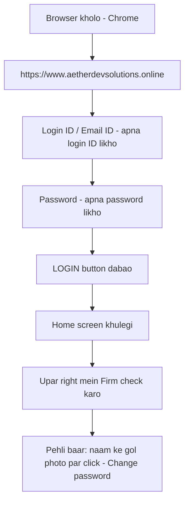

**Steps:**
1. Chrome (ya koi bhi browser) kholiye.
2. Address mein likhiye: **https://www.aetherdevsolutions.online**
3. **"Login ID / Email ID"** mein apna login ID likhiye (jaise `sales8`). Login page par koi ID / password pehle se likha nahi aata — khaane khaali milte hain. Ye theek hai, aisa hi hona chahiye.
4. **"Password"** mein apna password likhiye.
5. **LOGIN** button dabaiye. "Welcome to OmGold ERP" likha aayega aur **Home** screen khulegi.
6. Kaam khatam ho to upar right mein apne naam ke gol (circle) par click karke **"Sign out"** dabaiye.

**Apna password badalna (Change password):**
1. Upar right mein apne naam ke **gol photo** par click → **"Change password"** (chaabi icon).
2. **"Current password"** — abhi wala password.
3. **"New password (min 8 characters)"** — naya password, kam se kam 8 akshar. Purane jaisa nahi chalega.
4. **"Confirm new password"** — naya password dobara, bilkul waisa hi.
5. **"Change password"** button dabaiye.
6. Password badalte hi **dusre computer / mobile par jahan bhi isi ID se login tha, wahan se logout ho jaata hai.** Wahan naye password se dobara login karna padega.

**Staff ka password bhool gaya / badalna hai (sirf owner):**
- **Setup → Settings → "People" → "Staff & User Management"** table mein us staff ki line par **chaabi (key) icon** ("Reset password") → naya password do baar → **"Reset password"**.

**Galat password baar-baar:**
- Ek hi login ID par **10 baar galat password** daalne par wo ID **15 minute ke liye band** ho jaati hai. 15 minute ruk kar sahi password se login karein.
- Login page par **"Forgot password?"** likha hai par abhi wo kuch nahi karta (section 17). Password bhool jaayein to owner Setup se reset kare; owner khud bhool jaaye to software wale se reset karwayein.

**Firm (dukaan) badalna:**
- Upar right mein ek button hai jismein building ka icon aur aapki firm ka **code** likha hota hai (jaise `JBS`). Use dabaiye → **"All Firms"** list khulegi → jis firm mein kaam karna hai uspar click kariye.
- Hara (green) dot wali firm abhi chal rahi hai.
- Chuni hui firm page refresh (reload) karne ke baad bhi wahi rehti hai.
- **Dhyan:** har bill, girvi, stock usi firm mein jaata hai jo upar chuni hui hai. Kaam shuru karne se pehle firm zaroor dekh lein.

---

## 2. Screen ki pehchaan

**Left side menu (sidebar)** — teen hisson mein:

| Group | Menu | Kis kaam ka |
|---|---|---|
| **At the counter** | **Home** | Aaj ka rate, customer dhoondhna, aaj ke zaroori kaam |
| | **Customers** | Customer, Supplier, Karigar, Staff, Money Lender |
| | **Stock** | Maal ki list, naya maal, tally, transfer, hallmark, melting |
| | **Billing** | Sale bill, purchase bill, quotation, order, repair |
| | **Gold Loan** | Girvi loan aur Girvi Calculator |
| **Money & books** | **Udhaar** | Lena-dena (udhaar) |
| | **Schemes** | Gold savings / kitty scheme |
| | **Expenses** | Dukaan ka kharcha |
| | **Follow-ups** | Reminder aur SMS |
| | **The Books** | Day Book, Ledger, GST, P&L, Balance Sheet, Reports |
| **Setup** | **Online Store** | Online dukaan (abhi chalu nahi — section 17 dekhein) |
| | **Print** | Barcode label, bill ka design, girvi ke kagaz |
| | **Setup** | Settings, Firms, System Logs |

Kai menu ke andar upar **tabs** hote hain. Jaise **Billing** ke andar: "Sell & Purchase", "Quotations", "Orders", "Repairs".

**Upar wali patti (top bar):**
- **"Search customers, stock, loans…"** — kuch bhi dhoondhne ke liye. Keyboard par `/` dabane se bhi khulta hai.
- **Barcode icon** — barcode scanner se item scan karne ke liye.
- **22K / 24K / SILVER** rate — aaj ka rate (badi screen par dikhta hai). Rate bhara hi nahi hai to wahan **"Rate not set"** likha aata hai — us par click karne se seedha rate bharne wali jagah (Daily Rates) khulti hai. Software apni taraf se koi rate nahi dikhata.
- **"Add Customer"** (+) — jaldi se naya customer.
- **Firm button** — firm badalne ke liye.
- **Chaand / Suraj icon** — dark / light screen.
- **Ghanti (bell)** — overdue loan aur pending kaam.
- **Gol photo** — **"Change password"** aur **"Sign out"**.

Mobile par menu chhupa rehta hai — upar left ke **teen line (☰)** icon se khulta hai.

---

## 3. Pehle kya add karein (first-time setup)

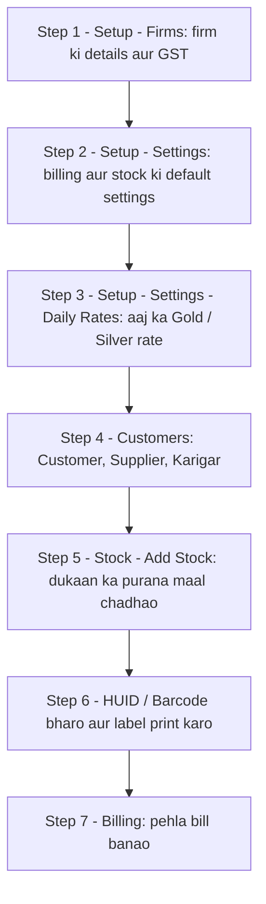

Ye order isliye zaroori hai: bill par firm ka naam aur GST chahiye (step 1), rate chahiye (step 3), customer chahiye (step 4), aur bechne ke liye stock chahiye (step 5).

### Step 1 — Firm ki details aur GST

1. Menu mein **Setup** dabaiye → upar tab **"Firms"** dabaiye.
2. Aapki firm ka card dikhega. Card par **"Firm details / Edit"** button (gear ⚙ icon ke saath) dabaiye. Ye sirf owner ke liye khulta hai.
3. **"Firm setup — (code)"** khulega. Ye bharein:
   - **Firm Name \*** (zaroori), **Legal Name**
   - **GSTIN**, **PAN**
   - **Phone**, **Email**, **Address**, **City**, **State**, **Pincode**
   - **State sahi bharna bahut zaroori hai.** Customer dusre state ka ho to software IGST lagata hai, same state ka ho to CGST + SGST.
4. **"Tax"** hissa: **"Charge GST on sales"** on rakhein. **CGST %** = `1.5`, **SGST %** = `1.5`, **IGST %** = `3` (sona-chaandi par kul 3% GST).
5. **"Licences"**: girvi ka kaam karte hain to **"Money-lender / pawnbroker licence no."** bharein. Ye girvi ke kagaz par chhapta hai.
6. **"Branding"**: dukaan ka logo upload karein. Ye bill ke upar chhapta hai.
7. **"Loyalty"**: har ₹100 ki kharidi par kitne point milenge.
8. **"Save Firm"** dabaiye. "(code) saved" aayega.

Nayi firm (dusri dukaan) banani ho to isi page par upar **"Add Firm"** dabaiye → **Firm Code \*** aur **Firm Name \*** zaroori → **"Create Firm"**.

### Step 2 — Settings (bill aur stock ki default settings)

1. **Setup** → tab **"Settings"**.
2. **"Screen & keyboard"**: **"Move to the next field with"** mein **"Enter key (and Tab)"** chunein agar aapke staff ko Enter dabakar agle khane mein jaane ki aadat hai.
3. **"Calculation settings"** hissa — yahan **"Add Stock options"**, **"Sell options"**, **"Purchase options"**, **"Old metal / URD options"**, **"Rate cut / No rate cut"** cards hain. Ye sirf **shuruaati (default) value** hain — bill banate waqt har line par badal sakte hain. Inhe badalne se purane bill nahi badalte. Agar samajh na aaye to jaise hai waise chhod dein, ya apne CA / software wale se ek baar set karwa lein.
4. **"Money and tax"**:
   - **"Cash & PAN limit"**: **"Cash limit on a sale"** — is se zyada cash par software customer ka PAN maangega (Rule 114B). Apne CA se poochkar bharein. `0` = koi limit nahi. Har box ke saamne **Save (💾)** button dabana hai.
   - **"TCS on big buyers"**: sirf tab on karein jab CA bole.
5. **"People"** → **"Staff & User Management"**: **"Add Staff"** se staff ka login banaiye — **Full Name \***, **Login ID \***, **Password \***, **Role** (Manager / Staff). Staff ko apna (owner wala) password kabhi na dein. Kisi staff ka password badalna ho to us line par **chaabi (key) icon** → **"Reset password"**.

### Step 3 — Aaj ka Gold / Silver rate

Rate **Home** screen par sirf dikhta hai — wahan badla nahi jaata. Rate yahan bharte hain:

1. **Setup** → **"Settings"** → **"At the counter"** hisse mein **"Daily Rates"** (आज का भाव) card.
   (Ya **Setup → Firms** mein firm card par **"Daily Rates"** button.)
2. **Pehli baar** (jab "No rates entered yet for this firm." likha ho):
   - **"Add rate"** dabaiye.
   - **Metal**: Gold, **Purity / karat**: `24K`, **Quoted per**: `10 gram`, **Rate (₹)**: aaj ka 24K rate → **"Add"**.
   - Phir se **"Add rate"**: Metal **Silver**, Purity `999`, Quoted per `1 kg`, rate → **"Add"**.
   - 22K, 18K jaise baaki karat software 24K se khud bana kar dikha deta hai (peele / amber khane mein, "new" likha hua). Theek lage to rakhein, warna khud number likhein.
3. **Roz** (har subah):
   - Table mein har line ke saamne **"New rate"** khane mein aaj ka rate likhein. 24K likhte hi baaki gold karat apne aap bhar jaate hain (amber). Kisi ko badalna ho to us par khud likh dein.
   - **"Save all new rates"** dabaiye. "Updated N rates" aayega.
4. Check karein: **Home** par **22K / 24K / 999** tile mein naya rate dikhna chahiye, aur upar patti mein bhi.
5. Purane din ke rate dekhne ho to **"Show history"**.

**Dhyan:** Bill mein **"Gold Rate /10gm"** aaj ke Daily Rates se hi aata hai. Aaj ka rate nahi bhara to upar ki patti par **"Rate not set"** dikhega, aur naye bill mein Gold Rate khaana khaali rehkar **"Set today's rate"** bolega. Isliye **roz subah rate bharna zaroori hai.**

### Step 4 — Customers, Suppliers, Karigar

1. Menu **Customers** dabaiye. Upar tabs: **Customers, Suppliers, Staff, Karigar, Money Lenders, Visitors**.
2. **"Add Customer"** dabaiye (har tab par yahi button hai). Jis tab par khade hokar dabayenge, wahi type pehle se chuna aata hai — jaise **Suppliers** tab par dabane se supplier banega, **Karigar** tab par karigar.
3. Zaroori khane: **First Name \*** aur **Mobile \***.
4. **User Type** mein check karein: customer / supplier / karigar / staff / moneyLender. Zaroorat ho to yahan se badal sakte hain.
5. Baaki jaankari (zaroorat ho to): Father/Spouse Name, Address, City, Village, State, PAN Number, GSTIN, Aadhaar, Bank details, Nominee.
6. Kisi ka purana hisaab (udhaar ya sona baaki) hai to: **Opening Balance** + **Balance Type** (Debit = usse lena hai, Credit = usko dena hai), **Gold Weight Balance**, **Silver Weight Balance**.
7. **"Save"** dabaiye. "Customer added" aayega.
8. Customer list mein **"Opening Bal."** column sirf wo **shuruaati (opening) baaki** dikhata hai jo aapne form mein bhara tha — aaj ka live baaki nahi. Aaj ka asli baaki dekhna ho to customer ke naam par click karke **Outstanding** dekhein.

**Jaldi wala tareeka:** Home par **"Customer at the counter"** box mein mobile number likhein. Na mile to **"Add (number)"** button aata hai → chhota form (**Mobile Number \***, **First Name \***, City, User Type) → **"Save Customer"**.

**Customer ka poora hisaab:** list mein customer ke naam par click karein. Khulega: **Outstanding**, **Gold Balance**, **Loyalty**, aur tabs **TRANS, SELL, PURCHASE, MONEY, LOANS, OTHER, Details**. Yahin se **"New Sale"**, **"New Loan"**, **"New Order"**, **"Udhaar Diya (Given)"**, **"Udhaar Liya (Taken)"** jaise button seedhe us customer ke liye kaam shuru karte hain.

### Step 5 — Dukaan ka purana maal chadhana (Add Stock)

Jo maal **pehle se dukaan mein hai**, wo **Add Stock** se chadhaiye. (Supplier se naya maal aaye to section 5 wala **Purchase** use karein.)

1. Menu **Stock** → tab **"Add Stock"** (ya Stock page par **"Add Stock"** button).
2. Upar category chunein: **Fine Stock** (sona / chaandi zevar), **Imitation**, **Raw Metal** (bar / bullion), **Diamond/Stone**.
3. Zaroori khane:
   - **Item Name \*** (jaise "Ladies Ring")
   - **Gross Wt (GS WT)** — kaanta wala vazan
   - **Less Wt** — stone / dhaaga ka vazan (ho to)
   - **Metal** aur **Tunch / Purity %** ya **Purity in Carat**
   - **Rate** — Daily Rates se apne aap amber rang mein aata hai
4. Kaam ke khane: **Category** (Ring, Chain…), **Item Code** (khaali chhodein to software khud banata hai), **Barcode**, **Hallmark UID**, **Counter**, **HSN Code**.
5. Making / Labour / Other / Hallmark charges neeche wale table mein.
6. Neeche patti mein **MRP**, **SELL**, aur **FINAL VALUATION** dikhega.
7. **"Save Stock"** (upar) ya **"+ ADD STOCK"** (neeche) dabaiye. "Stock item saved successfully" aayega. Form khaali ho jaata hai taaki agla item chadha sakein.

**Save ke baad kya hota hai:** item **Stock** list mein "available" ban jaata hai. Hisaab mein ye maal aapki **capital (poonji)** ke roop mein chadhta hai — supplier ki kharidi ke roop mein nahi. Isliye supplier se aaya naya maal yahan se **mat** chadhaiye.

### Step 6 — HUID / Barcode aur label print

1. Add Stock form mein **Barcode** aur **Hallmark UID** (6 akshar ka HUID) bharein.
2. Save karte waqt agar label printer set hai to message ke saath **"Print tag"** button aata hai — dabaiye.
3. Baad mein label chahiye: **Stock** → card kholiye (jaise "Gold Stock") → item kholiye → **"Thermal Tag"**.
4. Ek saath bahut saare label: **Print** menu → tab **"Bar-Code Print Panel"**. Range se print: **"PRN print by barcode no. range"** mein From / To likhkar **SUBMIT**.
5. **Pehli baar** is panel mein aapke label printer ki file (.prn) chahiye — "This tab has no printer file yet" likha ho to **"Upload .prn"**. Ye kaam software wale / printer wale se ek baar karwa lein.

### Step 7 — Pehla bill

Ab section 4 ke hisaab se pehla bill banaiye.

---

## 4. Sale bill banana (Billing)

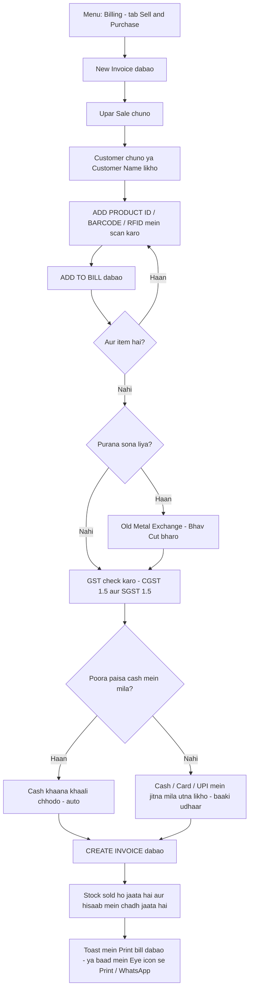

**Steps:**
1. Menu **Billing** → tab **"Sell & Purchase"** → **"New Invoice"**.
   (Ya Home par customer dhoondh kar **"New Sale"**.)
2. Upar teen button: **Sale**, **Purchase**, **URD Purchase**. **Sale** chuna hona chahiye. Title "New GST Invoice" dikhega.
3. **Customer** list se chunein — naam, mobile, address apne aap bhar jaate hain. Customer save nahi hai to sirf **Customer Name \*** likh dein.
   - Neeche likha aata hai **"Intra-state (CGST + SGST)"** ya **"Inter-state (IGST)"** — ye customer ke **State** se tay hota hai.
   - Customer ka purana **Advance** ya **Previous due** ho to peele box mein dikhega. Tick karke is bill mein adjust kar sakte hain.
4. **Gold Rate /10gm** apne aap aaj ke Daily Rates se aata hai. Khaali ho aur **"Set today's rate"** likha ho, to aaj ka rate nahi bhara gaya — pehle Setup → Settings → Daily Rates bharein (section 3, step 3), ya isi khaane mein haath se likh dein.
5. **Item daalna:** **"ADD PRODUCT ID / BARCODE / RFID"** box mein barcode scan karein ya code likhein → Enter / **GO**.
   - Ek item mile to uski line khul jaati hai (vazan, purity, rate, making). Check karein → **"ADD TO BILL"**.
   - Stock mein na ho to "is not present in the stock list" aayega → **"Enter it manually"** se haath se likh sakte hain.
   - Line badalni ho to table mein **pencil** icon → badlein → **"UPDATE LINE"**. Hatana ho to **laal dustbin**.
6. **Purana sona (exchange)** — section 4.1 dekhein.
7. **GST:** **CGST %** 1.5 aur **SGST %** 1.5 (ya **IGST %** 3) — firm setup se apne aap aata hai.
   - **"Tax by value"** tick karein agar aapne jo rate likha usmein GST pehle se shaamil hai.
8. **Discount (₹)** ho to likhein. Loyalty points use karne ho to **"Redeem Points"**.
9. **Paisa (payment):** neeche **"Amount Received"** mein: **Cash (₹)**, **Card (₹)**, **UPI (₹)**, **Cheque (₹)**, **Gold (₹)**. Jitna jis tareeke se mila, utna likhein. Mila-jula bhi chalega (jaise ₹50,000 Cash + ₹30,000 UPI). Alag se "Payment Mode" chunne ki zaroorat nahi — software in khaano se khud samajh leta hai.
   - **Cash khaana khaali chhoda** (andar halka sa **"auto …"** likha dikhta hai) = baaki bachi poori raqam **cash mein mili** maani jaayegi.
   - **Cash mein koi bhi raqam likhi — 0 bhi** = software **bilkul utna hi** cash maanega. Jo kam pada wo customer ke khaate mein **UDHAAR (credit)** chadhega. Neeche saaf likha aata hai: **"₹X will be left on credit to (customer ka naam)"** — ek baar padh lein.
   - **Udhaar wala bill** sirf **asli customer ke naam** par banta hai. Naam "Cash" ya "Walk-in" ho to software rok dega — customer ka sahi naam likhein / chunein, ya poori raqam Cash / Card / UPI mein bharein.
10. Neeche **"FINAL INVOICE AMOUNT"** dekh lein → **"CREATE INVOICE"** (hara button). "Invoice created" aayega.
11. **Print:** bill bante hi neeche ek chhota message (toast) aata hai jismein **"Print bill"** button hota hai — dabaiye, bill ka print khul jaayega. Wo message chala gaya ho to list mein bill ki line par **aankh (Eye)** icon → **"Print"** ya **"WhatsApp"**.
12. Bill ko beech mein "hold" (rok kar baad mein poora) karne ka button ab nahi hai — bill ek baar mein poora karein.

**Save ke baad apne aap kya hota hai:**
- Bechi gayi item Stock mein **"sold"** ho jaati hai (list se hat jaati hai, "Sold Out Stock" mein chali jaati hai).
- Bikri, GST aur paisa **Day Book / Ledger** mein apne aap chadh jaata hai.
- Customer ko loyalty points mil jaate hain.
- **"Update inventory"** tick hata diya to stock nahi ghatega ("MEMO BILL") — ye tick normally laga rehne dein.

### 4.1 Purana sona lena (Old Metal Exchange / Bhav Cut)

1. Sale bill mein **"Old Metal Exchange (Bhav Cut)"** patti par click karein — khul jaayegi.
2. **"Add row"** dabaiye. Har purane zevar ke liye: **Type**, **Description**, **Gross wt (g)**, **Less wt (g)**, **Tunch %**, aur rate / **Value ₹**.
3. **"Old metal settled by"** chunein:
   - **"Cash — valued in rupees, no netting"** — purana sona rupaye mein gina jaayega (normal tareeka).
   - **"No rate cut — metal to metal, in full"** — sona ke badle sona, poora.
   - **"Rate cut — metal to metal, rest at today's rate"** — sona ke badle sona, kam pada to baaki aaj ke rate se.
4. Cash wale tareeke mein **"Bhav cut (cash)"**: koi kati nahi / ₹ per 10 gm / flat ₹.
5. **"Net Old Metal Value (₹)"** apne aap neeche **Gold (₹)** khane mein chala jaata hai aur customer ka dena kam ho jaata hai.
6. Purane sone par GST nahi lagta — wo payment ki tarah ginta hai.

### 4.2 Bill galat ban gaya ya maal wapas aaya

Bill save hone ke baad **badla (edit) nahi ja sakta.** Do raaste hain:

- **Maal wapas (Return / Credit Note)** — sahi tareeka:
  1. **Billing** → bill ki line mein **Eye** icon → **"Return / Credit Note"**.
  2. Jo item wapas aayi uspar tick karein (poora bill ya kuch item).
  3. **Reason \*** likhein. **"Refund via"**: customer ke khaate mein adjust / Cash / Card / UPI / Cheque.
  4. **"Post Return"**. Item wapas stock mein aa jaati hai, GST aur hisaab ulta ho jaata hai.
  - Jaldi tareeka: naye Sale bill mein laal box **"RETURN PRODUCT ID / BARCODE"** mein wapas aayi item scan karein — software us item ka purana bill khol deta hai. Yahan **poora aur sahi** barcode / item code / HUID likhna hota hai (jaise `DEMO-G22R1` ya `TST001`) — aadha naam likhne se nahi milega.
- **Bill delete (sirf owner / manager):** list mein laal **dustbin** → "Delete this invoice?" → OK. Bill **"Deleted"** tab mein chala jaata hai, hisaab ulta ho jaata hai, aur bechi item wapas "available" ho jaati hai. Phir sahi bill dobara banaiye.
- Bill ki list mein upar tabs: **Invoices / Returned / Deleted** aur **All / Sale / Purchase / URD**.

---

## 5. Supplier se maal kharidna aur Add Stock + barcode label

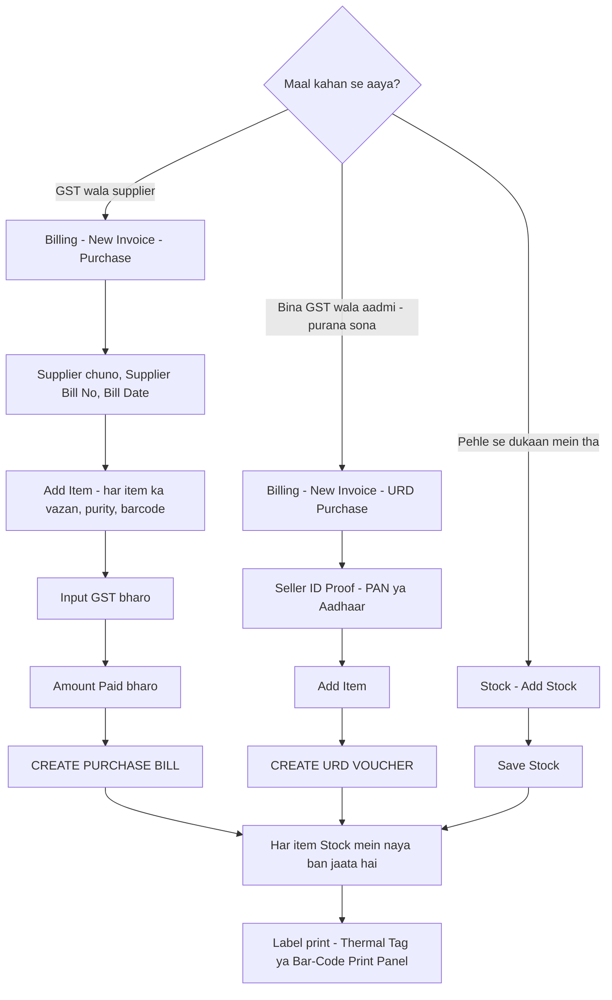

### 5.1 GST supplier se kharidi (Purchase)

1. **Billing** → **"New Invoice"** → upar **Purchase** chunein (ya list mein **Purchase** tab chunkar **"New Purchase"**). Title "New Purchase Bill".
2. **Supplier** chunein (pehle Customers mein User Type = supplier banaya hona chahiye). Ya **Supplier Name \*** likhein.
3. Supplier ke bill se: **Supplier Bill No**, **Bill Date**, **Due Date**, **Payment Terms**.
4. **"Add Item"** → har item: **Item Name \***, Metal, Purity, **Gross Wt**, **Less Wt**, Rate, Making, **HSN Code**, **Barcode** (ho to), **HM UID** → **"ADD TO BILL"**.
5. GST box ("INPUT TAX (GST — from supplier bill)") supplier ke bill se milayein.
6. **"Amount Paid"**: jitna supplier ko diya, utna Cash / Card / UPI / Cheque mein. Sale jaisa hi niyam: Cash **khaali** = baaki poora cash mein diya; Cash mein koi raqam (0 bhi) likhi = bilkul utna, baaki supplier ka **dena (Balance Payable)** ban jaata hai.
7. **"CREATE PURCHASE BILL"**. "Purchase bill created" aayega.
8. **Save ke baad:** har line **Stock** mein ek naya "available" item ban jaati hai, aur purchase + input GST hisaab mein chadh jaata hai.

### 5.2 Bina GST wale se purana sona (URD Purchase)

1. **Billing** → **"New Invoice"** → **URD Purchase**.
2. **Seller** ka naam. **"Seller ID Proof"**: **ID Type** (PAN / Aadhaar / Other) + **ID Number** — zaroor bharein, yahi saboot hai.
3. **"Add Item"** se vazan, tunch, rate.
4. **"CREATE URD VOUCHER"**. Is par GST nahi lagta. Maal stock mein (Raw Metal) chadh jaata hai.

### 5.3 Label print

Section 3, Step 6 dekhein (**"Thermal Tag"** ya **Print → "Bar-Code Print Panel"**).

---

## 6. Quotation, Order aur Repair

Ye teeno **alag-alag kaam** hain. Quotation se seedha Order nahi banta, aur Order se seedha bill nahi banta (Order taiyaar hone par Billing mein Sale bill banta hai, advance usmein adjust hota hai).

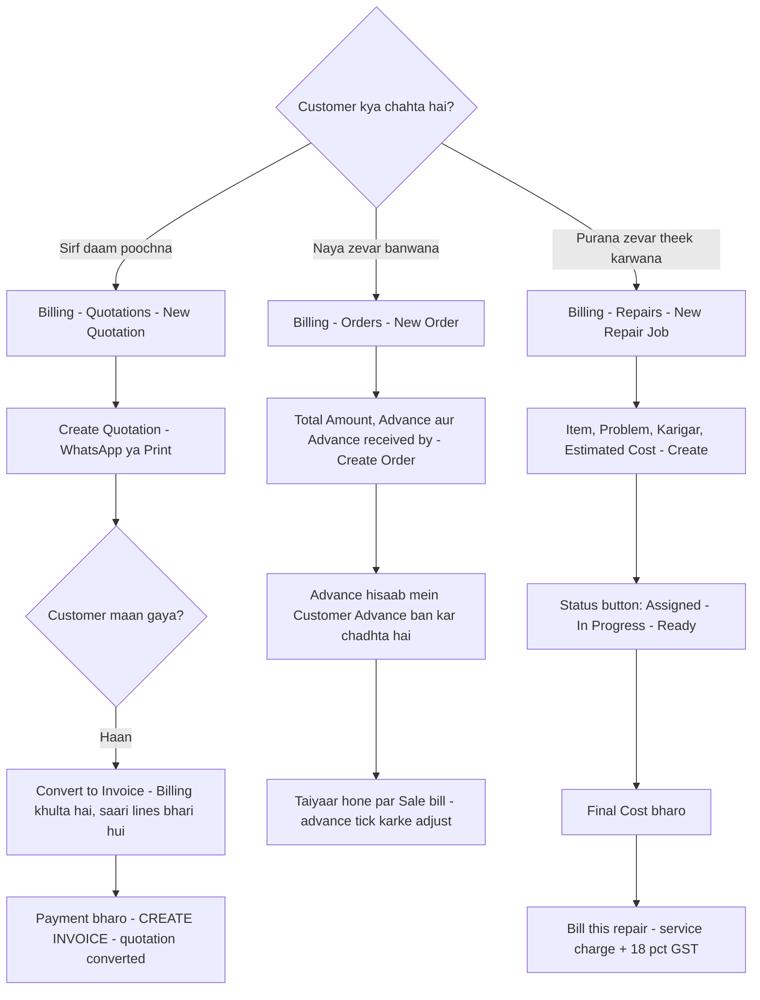

### 6.1 Quotation / Estimate

1. **Billing** → tab **"Quotations"** → **"New Quotation"**.
2. **Customer** chunein ya **Customer Name \***. **Type**: Quotation ya Estimate. **Valid Till**, **Gold Rate /10gm**.
3. Stock se item jodein, **Discount (₹)**, **Note**.
4. **"Create Quotation"**.
5. List mein: **WhatsApp** icon se bhejein. **Eye** se dekhein. Eye ke andar **"Print"** sirf quotation ka kagaz chhapta hai.
6. Customer maan jaaye: **"Convert to Invoice"** (do teer wala icon, ya Eye ke andar button) → **Billing** ka naya Sale bill khulta hai jismein **customer aur quotation ki saari lines pehle se bhari** hoti hain.
   - Ab paisa normal bill ki tarah bharein (Cash / UPI / Card, ya udhaar — section 4, step 9) → **"CREATE INVOICE"**.
   - Bill save hote hi quotation apne aap **"converted"** ho jaati hai. Bill save nahi kiya to quotation waisi hi rehti hai.
7. Quotation **delete** sirf owner / manager kar sakta hai.
8. Quotation se stock nahi ghatta, hisaab mein kuch nahi chadhta — ye sirf daam ka kagaz hai.

### 6.2 Customer Order (naya zevar banwana)

1. **Billing** → tab **"Orders"** → **"New Order"**.
2. **Customer Name \***, Mobile, **Order Date**, **Delivery Date**, **Total Amount (₹)**, **Advance (₹)**, **Note** (design, vazan…).
3. Advance likha hai to **"Advance received by"** chunein: **Cash**, **UPI** ya **Bank transfer**.
4. **"Create Order"**. Advance ka paisa apne aap hisaab (Day Book / Ledger) mein **Customer Advance** ban kar chadh jaata hai.
5. Tabs: **Pending / In Progress / Delivered / Cancelled**. List mein status ke dropdown se badlein.
6. Zevar dene par **Billing** mein us customer ka Sale bill banaiye. Peele box mein customer ka **Advance** dikhega — tick karke is bill mein adjust kariye. Bas baaki paisa lena hai.

### 6.3 Repair

1. **Billing** → tab **"Repairs"** → **"New Repair Job"**.
2. **Customer Name \***, Mobile, **Item Name \***, **Item Description**, **Problem / Issue**, **Karigar Name**, **Intake Date**, **Expected Delivery Date**, **Estimated Cost (₹)**, **Advance Paid (₹)**.
3. **"Create Repair Job"** dabaiye.
4. Tabs: **Open / Received / Assigned / In Progress / Ready / Delivered / All**. Page **"Open"** tab par khulta hai — dukaan mein abhi jitne bhi repair pade hain (Received, Assigned, In Progress, Ready) sab ek saath dikhte hain. List mein agle status ka button dabate jaiye.
5. **Ready** karne par **"Marked as ready"** aata hai. Customer ko **WhatsApp** icon se khud bataiye — software apne aap SMS nahi bhejta.
6. **Final Cost:** job **Ready** ya **Delivered** ho to repair kholkar **"Final Cost (₹) - billed amount before GST"** bharein — asli kitna lena hai (GST se pehle).
7. **Bill:** **"Bill this repair"** (receipt icon) → service charge par **18% GST** lagta hai (SAC 9987) → **"Advance was collected by"** aur baaki paisa Cash / Card / UPI / Cheque → save. Final Cost nahi bhara ho to button par **"Set final cost & bill"** likha aata hai — pehle Final Cost bharein.

---

## 7. Girvi / Gold Loan

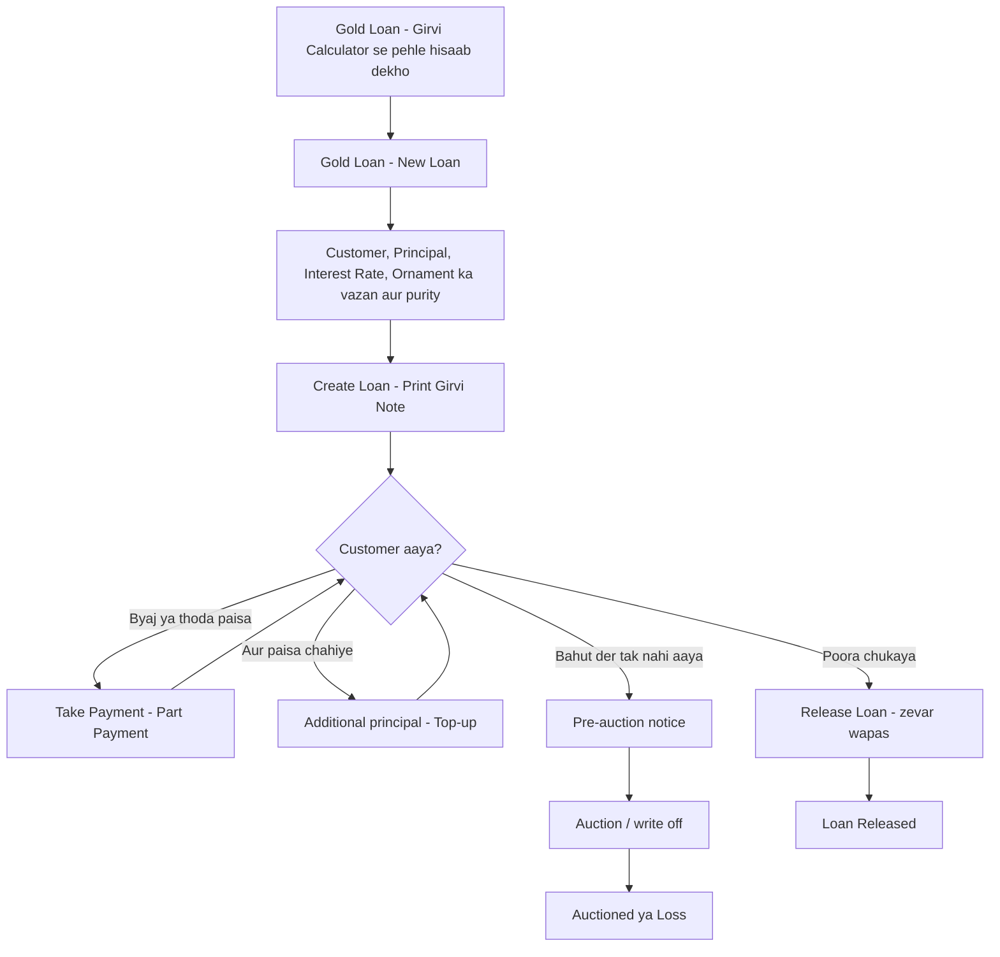

### 7.1 Girvi Calculator (loan dene se pehle)

1. **Gold Loan** → tab **"Girvi Calculator"**.
2. **Money Demanded (₹) \*** — customer kitna maang raha hai.
3. **GOLD ITEM**: **Net Weight**, **Unit**, **Purity (Tunch)**, **Rate /10gm (₹)**. Chaandi ho to **SILVER ITEM (optional)**.
4. **Interest Rate (%/month)**, **Months**, **Loan Date**, **Release Date (optional)**.
5. **Simple Interest** ya **Compound Interest**.
6. Software dikhata hai: Gold Value, Silver Value, kitna loan diya ja sakta hai (max loan), aur kitna byaj banega.
7. Ye sirf hisaab hai — kuch save nahi hota. **"Reset"** se saaf karein.

### 7.2 Naya Loan dena

1. **Gold Loan** → **"New Loan"**. "New Gold Loan (Girvi)" khulega.
2. **Customer** chunein ya **Customer Name \***, Mobile.
3. **Loan Type**: Secured Loan / Unsecured Loan.
4. **Principal Amount (₹) \***, **Interest Rate %/mo**, **Time Period (months)**, **Processing Fee (₹)** (ho to — customer ko itna kam haath mein milta hai).
5. **"Register details (ward, village, ex/tr/ml firm)"** — zaroorat ho to: Packet No, Box, Locker No.
6. **"Interest Convention"**: **Part month**, **Month length**, **Rate is per** (Month / Annum), **Interest** (Simple / Compound). Ek baar loan par likh gaya to baad mein nahi badalta.
7. Zevar: **"Add Item"** → **Ornament** (naam), **Purity** (sona: 22K / 24K / 18K / 20K; chaandi: Silver 999 / Silver 925 / Silver 80 / Silver 70 / Silver 50), **Gross (g)**, **Stone (g)**, **Net (g)**, **Value (₹)** (rate board se apne aap), **Photo**.
8. **"Create Loan"**. "Loan created" aayega. Loan zevar ki keemat se bahut zyada ho to chetavani aati hai.
9. Loan kholkar **"Print Girvi Note"** — customer ko parchi dein.
10. **Save ke baad:** paisa "Loans Given" mein chadhta hai aur cash ghatta hai (Day Book mein dikhega).

### 7.3 Byaj / part payment lena

1. **Gold Loan** list mein loan ki line par **₹ icon** ("Part payment"), ya loan kholkar **"Take Payment"**.
2. Upar dikhega: **Outstanding principal**, **Interest**, **"Total due today"**.
3. **Amount received (₹) \***, **Discount / rebate (₹)**, **Custody charge (₹)**, **Payment mode** (cash / bank / cheque / upi).
4. Software **pehle byaj** kaatta hai, phir baaki principal mein ("Applied interest-first").
5. Save. "Payment recorded".
6. **Byaj kaise banta hai:** loan ki tareekh aur har payment / top-up ki tareekh se software khud ginta hai. Alag se byaj chadhane ki zaroorat nahi.

### 7.4 Top-up (aur paisa dena)

1. Loan kholiye → neeche **teer (▼ "More actions")** → **"Additional principal"** (sirf owner / manager).
2. **Additional amount (₹) \***, **Date of this advance \***, **Paid out by**, Note → save.
3. Purana byaj principal mein nahi judta — alag se baaki rehta hai.

### 7.5 Release (zevar wapas dena / loan band)

1. List mein **taala (Release)** icon, ya loan kholkar **"Release Loan"**.
2. "Total due today" jitna amount likhein. Kam lena ho to farak **Discount / rebate** mein daalein (warna laal chetavani aati hai).
3. Save → "Loan released". Loan **released** tab mein chala jaata hai.
4. Agar zevar aage kisi financier ke paas girvi rakha (re-pledge) hai to pehle use chhudwaiye — software chetavani deta hai.

### 7.6 Auction aur Transfer

- **Pre-auction notice:** loan → **More actions** → **"Pre-auction notice"** — print karke customer ko dein.
- **Auction / write off** (sirf owner / manager): **More actions** → **"Auction / write off"**.
  - **Outcome**: "Auctioned — pledge sold" ya "Written off — nothing realised".
  - **Sale proceeds (₹) \***, **Auction charges (₹)**, **Sold to**, **Proceeds received in**.
  - Bacha paisa (Surplus) customer ko **wapas dena** hota hai — software laal / hare mein bata deta hai. Kam pada (Shortfall) to bad debt mein jaata hai.
- **Re-pledge to a financier:** jab aap customer ka zevar aage kisi bade financier ke paas girvi rakhte ho. **More actions** → **"Re-pledge to a financier"**. Baad mein **"Pay the financier"** se chhudwaate ho.
- **Papers:** **Form 7 — Register of Pledges**, **Form 8 — Register of Redemptions** (band loan ke liye), **Packet tag**.
- **Galti sudhaarna:** **More actions** → **"Correct loan details"**.
- **Delete** (dustbin) button sirf tab dikhta hai jab loan delete karna sahi ho — jaise jis loan par koi payment nahi hui aur wo active / released nahi hai. Chalu loan ko delete nahi, **Auction / write off** ya **Release** se band kariye.
- Tabs: **active / released / auctioned / loss / transferred / Under review**. **"Under review"** = loan ko packet se milane ke liye alag rakha hai; isse hisaab mein kuch nahi badalta aur wapas Active kar sakte hain. **"Filters"** se gaon, box, byaj baaki waale loan chhaant sakte hain.

---

## 8. Udhaar (diya / liya)

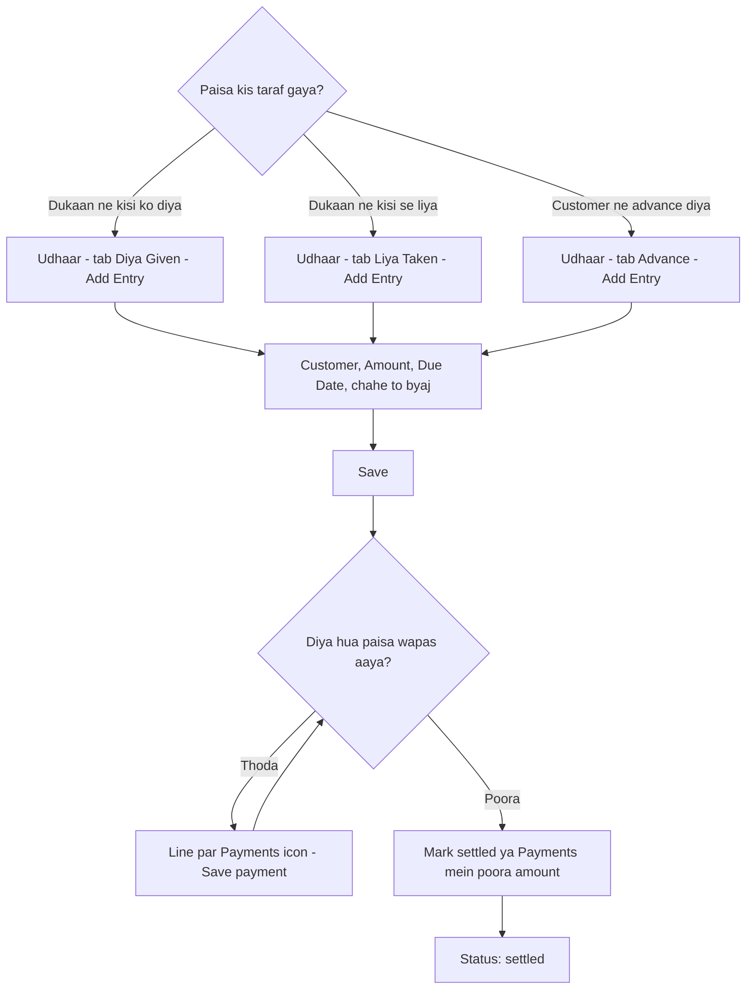

**Tabs ka matlab:**
- **"Diya (Given)"** — **aapne udhaar diya** (paisa dukaan se gaya, aapko wapas lena hai).
- **"Liya (Taken)"** — **dukaan ne kisi se paisa liya** (jaise money-lender ya supplier se). Money-lender / supplier / karigar se liya paisa hisaab mein **Sundry Creditors** (aapka dena / liability) mein chadhta hai.
- **"Advance"** — customer ne pehle se paisa diya (advance). Ye hisaab mein **Customer Advances** mein chadhta hai aur baad mein bill mein adjust ho sakta hai.

**Naya udhaar:**
1. Menu **Udhaar** → sahi tab chunein → **"Add Entry"**.
2. **Customer** chunein ya **Customer Name \***, Mobile, Village/City.
3. **Amount (₹) \***, **Transaction Type** (Cash / Bank / Cheque), **Due Date**, **Description**.
4. Byaj lena ho to **"Charge interest"** switch on karke **Interest rate (%) \***, **Per** (per month / per year / per day), **Interest from**. Kisht (EMI) mein lena ho to **Repay every** aur **Number of installments \***.
5. **"Save"**. "Entry added". Hisaab mein apne aap chadhta hai.

Home par customer chunkar **"Udhaar Diya (Given)"** aur **"Udhaar Liya (Taken)"** button bhi yahi kholte hain.

**Diya hua paisa wapas aaye to:**
1. **Diya (Given)** tab mein us line par **haath-sikka (Payments)** icon.
2. **Amount (₹) \***, **Date**, **Payment mode** (Cash / Bank / UPI) → **"Save payment"**.
3. Poora mil gaya to **sahi ka nishaan ("Mark settled")** dabaiye. Byaj wali entry par ye seedha Payments kholta hai, poori raqam bhar ke.
4. Galti se **Liya (Taken)** mein nayi entry daalne lage, aur us aadmi ka pehle se koi khula "Diya" hai, to software khud poochta hai: **"Record as repayment of ₹… given on …"** — use chuniye. Isse paisa purani Diya line mein jama hoga aur wo line sahi band hogi.

**Kaam ki cheezein:**
- **"Overdue only"** — sirf wo jinki due date nikal gayi.
- Upar likha rehta hai **Outstanding** aur **Overdue** kitna hai.
- Home par **"Money to receive"** tile bhi yahi dikhata hai.

---

## 9. Savings Scheme (gold kitty)

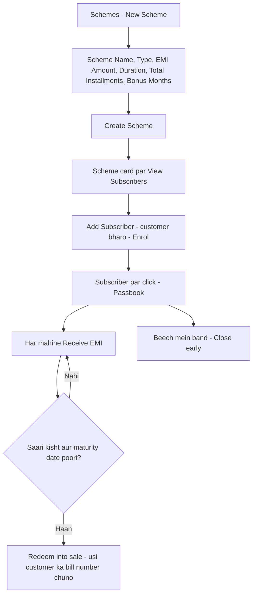

**Scheme banana (ek baar):**
1. Menu **Schemes** → **"New Scheme"**.
2. **Scheme Name \***, **Group Name**, **Type**:
   - "Cash — a fixed rupee bonus" (rupaye wali)
   - "Gold — instalments buy grams at the day's rate" (har kisht se gram jama)
   - "Silver — …"
3. **EMI Amount (₹) \***, **Duration (months)**, **Total Installments**, **Bonus Months**, Description.
4. **"Create Scheme"**.

**Customer jodna:**
1. Scheme card par **"View Subscribers"** → **"Add Subscriber"**.
2. **Customer** / **Customer Name \***, Mobile, **Start Date**, **EMI (Rs)**, **Bonus at maturity (Rs)**, **Early-exit deduction (Rs)**, **Nominee**.
   - Gold / Silver scheme mein aaj ka rate (**₹ per gram**) bhi maangta hai.
3. **"Enrol"**.

**Har mahine kisht:**
1. **View Subscribers** → customer ke naam par click → **Passbook** khulega (Paid, Deposited, Grams accumulated).
2. Gold / Silver scheme ho to aaj ka **rate per gram** apne aap Daily Rates se bhar jaata hai (neeche likha aata hai "Daily Rates board: … per gram"). Daily Rates nahi bhara to haath se **per gram** rate likhein (10 gram ka rate ÷ 10).
3. **"Payment mode (instalment / refund)"** chunein: **Cash / UPI / Bank / Card**.
4. **"Receive ₹(EMI)"** dabaiye.
5. Subscriber list mein "missed" (laal) aur "due" (peela) dikhta hai.

**Maturity / band karna:**
- **"Redeem into sale"** (owner / manager): pehle **Billing** mein usi customer ka Sale bill banaiye. Phir yahan **"Redeem into sale"** dabaiye → ek dialog khulta hai jismein **bill number** likhte hi software bill ka customer, tareekh aur total dikhata hai. Bill **usi customer ka** na ho to Redeem nahi hone deta.
- **"Close early"**: beech mein band. Jama paisa wapas, bonus nahi.

---

## 10. Expenses (dukaan ka kharcha)

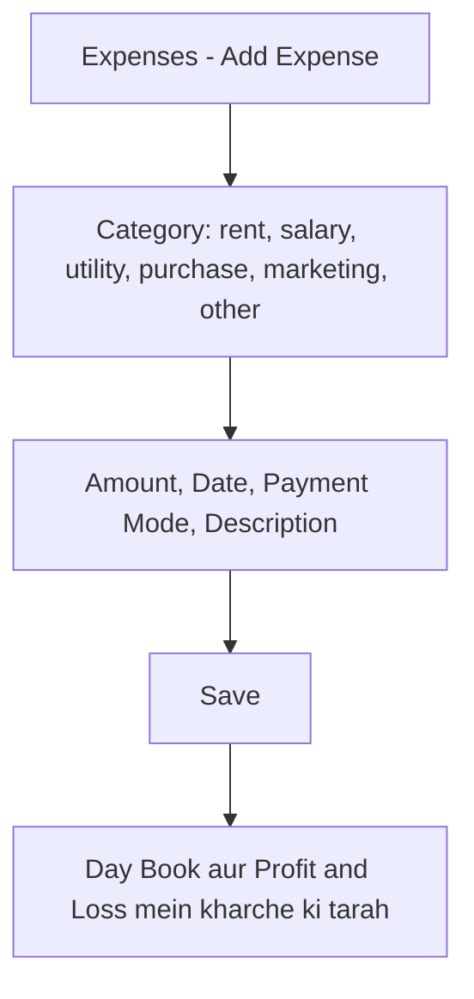

1. Menu **Expenses** → **"Add Expense"**.
2. **Category** (rent / salary / utility / purchase / marketing / other), **Amount (₹) \***, **Date**, **Payment Mode**, **Description**.
3. **"Save"**. "Expense added".
4. Upar **Total** dikhta hai. Category ke dropdown se chhaant sakte hain.
5. **Payment Mode** mein ye milte hain: **cash, bank, upi, card, cheque** — jis tareeke se kharcha diya, wahi chunein.
6. Supplier se maal kharidne ko yahan mat daaliye — wo Billing → Purchase se hota hai.

---

## 11. Stock Tally, Transfer, Hallmarking, Melting

Sab **Stock** menu ke andar tabs mein hain.

**Stock list khaali dikhe to:** agar internet / server ki dikkat se list load nahi hui, to laal box mein **"Could not load stock"** aur **"Retry"** button aata hai — Retry dabaiye. List bina is message ke khaali dikhe, tabhi maaniye ki us firm / filter mein maal nahi hai.

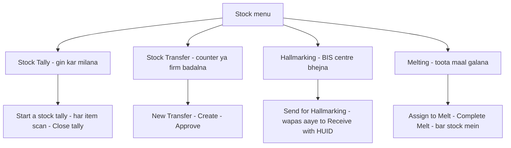

### 11.1 Stock Tally (shelf ka maal vs computer ka maal)

1. **Stock** → **"Stock Tally"**.
2. Chahein to Counter / Location / Category chunein → **"Start a stock tally"**.
3. **"Scan or type a barcode / RFID / item code, then Enter"** box mein har item scan karein.
4. Upar ginti: **Expected** (computer mein), **Counted** (mila), **Missing** (computer mein hai, shelf par nahi), **Extra** (scan hua par list mein nahi).
5. "Scan box is not active" dikhe to us patti par click karke phir scan karein.
6. Khatam: **"Close tally"**. **"Print"** se report. Tally se stock khud nahi badalta — Missing item ki jaanch aapko karni hai.

### 11.2 Stock Transfer

1. **Stock** → **"Stock Transfer"** → **"New Transfer"**.
2. **Stock Item**, **From Counter**, **To Counter**, ya **Transfer to Firm (optional)**, Note → **"Create Transfer"**.
3. Transfer "pending" rehta hai. Owner / manager **sahi (Approve)** ya **X (Return)** dabate hain.

### 11.3 Hallmarking

1. **Stock** → **"Hallmarking"** → **"Send for Hallmarking"**.
2. Items par tick, **Centre Name**, Note → **"Send"**. Ek **lot number** banta hai.
3. Wapas aane par lot ki line par **"Receive"** → har item ka **HUID** (6 akshar) aur **Fee ₹** → **"Receive"**. Item wapas stock mein HUID ke saath.

### 11.4 Melting / Refining

1. **Stock** → **"Melting"** → **"Assign to Melt"**.
2. **Metal** (Gold / Silver), toote / purane items par tick → **"Assign"**. Lot "In Melt" ho jaata hai.
3. Galne ke baad lot ki line par **"Complete"** → **Recovered Gross Weight (g)**, **Recovered Purity**, **Metal Rate (₹ per gram)** → **"Complete Melt"**.
4. Naya bar (bullion) **Raw Metal Stock** mein aa jaata hai. Ghaata (loss) bhi dikhta hai.

**Insights** tab: Fast movers (jaldi bikne wala), Dead stock (pada hua maal), Karigar, Re-order.

---

## 12. Hisaab-kitaab aur Reports (The Books)

Menu **The Books**. Har page par upar **From** aur **To** tareekh hai, aur saath mein jaldi wale button: **Today**, **This month**, **This FY** (1 April – 31 March). **Day Book** apne aap **Today** (aaj) par khulta hai. Baaki reports mein jo samay chahiye wo button dabaiye.

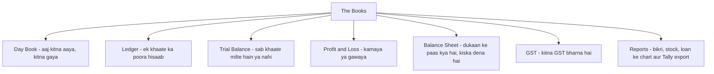

Sale, purchase, girvi, udhaar, scheme, expense — sab **apne aap** yahan chadhte hain. Yahan haath se kuch daalne ki zaroorat normally nahi hoti.

| Tab | Seedhe shabdon mein kya batata hai |
|---|---|
| **Day Book** | **"Aaj kitna aaya, kitna gaya."** Upar **"What moved in the books"** table: Cash / Bank ka Opening, **In**, **Out**, Closing. Shaam ko galle ka cash isse milayein. Neeche har entry. **Voucher** dropdown se sirf Sales / Gold loan / Expenses wagairah. |
| **Journal Book** | Wahi entries, tareekh ke hisaab se Dr / Cr format mein. CA ke kaam ka. |
| **Ledger** | **"Is khaate ka poora hisaab."** **Account** dropdown se khaata chunein (Cash, Sales, kisi party ka). Opening, Debit, Credit, Closing. |
| **Bank Rec** | Bank khaate. **"New Bank Account"** se bank jodein. Cheque **Clear** ya **Bounce**, bank statement milana. |
| **Trial Balance** | **"Saare khaate barabar hain ya nahi."** Neeche Dr aur Cr ka total barabar hona chahiye. Upar laal chetavani aaye to software wale ko batayein. |
| **Profit & Loss** | **"Is samay mein kitna kamaya ya gawaya."** Upar aamdani, neeche kharcha. |
| **Balance Sheet** | **"Dukaan ke paas kya hai (stock, cash, diye hue loan) aur kiska dena hai."** |
| **GST** | **"Kitna GST bharna hai."** Tabs: **Sales / Output**, **Purchases / Input**, **URD Register**. Output GST − Input GST = bharna. GSTR ke liye CA ko dein. |
| **Reports** | Total Sales, Purchases, Stock Value, Loan Outstanding, Expenses. Tabs: Sales Analysis, Purchases, Stock Analysis, Loan Analysis, Returned Items, Cancelled Bills, Raw Metal, **GST Sell Report**. **"Export to Tally"** se CA ke Tally ke liye file. |

---

## 13. Follow-ups, SMS, Print, System Logs

### 13.1 Reminders (kaam yaad rakhna)
1. **Follow-ups** → **"Reminders"** → **"Add Task"**.
2. **Task Subject \*** (jaise "Ramesh ji ko loan renewal ka phone"), **Category**, **Priority**, **Due Date**, **Note** → **"Save Task"**.
3. Ho jaaye to **sahi ka nishaan ("Mark done")**. Tabs: Pending / Done / All.
4. Pending kaam Home par **"Follow-ups"** tile mein aur upar **ghanti** mein dikhte hain.

### 13.2 SMS
1. **Follow-ups** → **"SMS"** → **"Send SMS"**.
2. Customer chunein ya **Mobile Number \***, **Template** ya apna **Message \*** (160 akshar) → **"Send SMS"**.
3. **Saaf baat:** abhi SMS ka koi asli gateway nahi juda — SMS **demo mode** mein hai — "SMS sent (demo mode)" aata hai, par **customer ke phone par asli SMS nahi jaata**. Customer ko kuch batana ho to customer list ya bill par **WhatsApp** icon use kariye.

### 13.3 Print
Menu **Print** ("Print Center"). Tabs:
- **Documents** — girvi note, Form 7 / Form 8 register, notices, day book print.
- **Bar-Code Print Panel** — zevar ke barcode label (section 3, step 6).
- **Invoice Layout** — bill ka design: firm info, logo, terms & conditions, bank details, kaun-se column chhapein. **"Discard changes"** se wapas.
- **Loan Documents** — girvi ke kagaz ka design, licence no., auction notice ke din.

### 13.4 System Logs (kisne kya kiya)
1. **Setup** → **"System Logs"**.
2. Har kaam ki list: **Time**, **User**, **Action** (create / update / delete), **Entity** (invoice, loan…), **Details**.
3. Koi bill delete hua ya rate badla — yahan pata chalta hai kisne aur kab.

---

## 14. Roz ka kaam (daily routine)

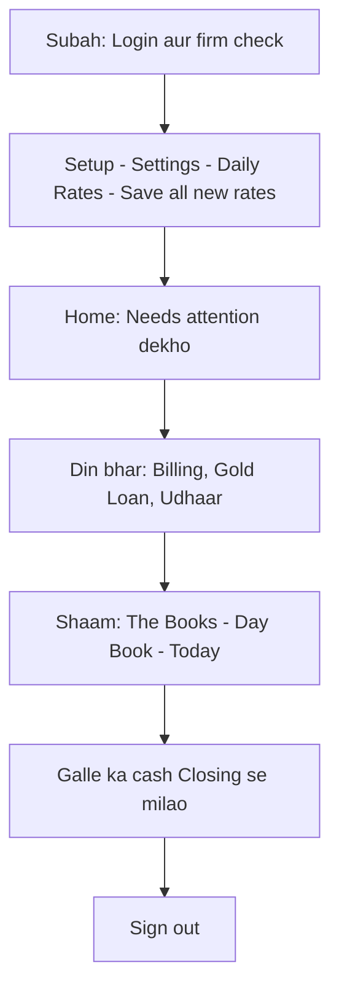

- [ ] Login karke upar **firm** sahi hai check karein.
- [ ] **Setup → Settings → Daily Rates** mein aaj ka rate → **"Save all new rates"**. Home par naya rate dikhe.
- [ ] **Home → "Needs attention"**: **Money to receive**, **Overdue loans**, **Repairs ready**, **Follow-ups** dekhein.
- [ ] Har bill ke baad toast ke **"Print bill"** (ya **Eye → Print**) se customer ko bill dein.
- [ ] Girvi ka byaj aaye to **Take Payment** se hi lein (haath se register mein nahi).
- [ ] Dukaan ka har kharcha **Expenses** mein daalein.
- [ ] Shaam ko **The Books → Day Book** (apne aap **Today** par khulta hai) → **"What moved in the books"** ka Cash **Closing** galle ke cash se milayein.
- [ ] Ghanti (bell) aur **Follow-ups** ke pending kaam dekh lein.
- [ ] **Sign out**.

---

## 15. Mahine ke end mein

- [ ] **Stock → Stock Tally**: ek counter ya poori dukaan ka tally karein. **Missing** list ki jaanch karein.
- [ ] **Gold Loan**: upar likha **"Overdue byaj"** dekhein. **Filters** se byaj baaki waale chhaant kar phone / WhatsApp karein. Bahut purane loan par **Pre-auction notice**.
- [ ] **Udhaar → "Overdue only"**: baaki wasooli ki list.
- [ ] **Schemes → View Subscribers**: "missed" (laal) kisht waalon ko yaad dilayein.
- [ ] **The Books → GST** (**This month** button, ya mahine ki From / To tareekh): Output, Input, URD Register — CA ko dein. **Reports → "GST Sell Report"** bhi.
- [ ] **The Books → Bank Rec**: bank statement se milayein, cheque **Clear / Bounce** karein.
- [ ] **The Books → Trial Balance**: upar koi laal chetavani to nahi.
- [ ] **The Books → Profit & Loss**: mahine ka munafa.
- [ ] **Expenses**: mahine ka total check karein (rent, salary daali ya nahi).
- [ ] **Reports → "Export to Tally"** — CA Tally use karta ho to file bhejein.
- [ ] **Setup → System Logs**: koi anjaana delete to nahi hua.

---

## 16. Demo data jo software mein daala gaya hai
<!-- DEMO-DATA-TABLE -->

Software ko chala kar dikhane ke liye firm **JBS — "Jai Bhavani Jewellers"** mein kuch **nakli (demo) entries** daali gayi hain. Inhe pehchaanna aasaan hai: har naam ke aage **TEST** aur har stock code ke aage **DEMO** likha hai.

**Kaise dhoondhein:** upar ki patti mein **"Search customers, stock, loans…"** (ya keyboard par `/`) → **`TEST`** likhein (customers, loan, scheme ke liye) ya **`DEMO`** likhein (stock ke liye).

**Hatana ho to:** ye aapki marzi hai — rakhein to seekhne ke kaam aayengi. Hatani ho to khud hatayein: bill → **Return / Credit Note** ya owner **Delete**; baaki cheezein unke apne page se. Asli kaam shuru karne se pehle inhe ek baar dekh lein taaki asli hisaab mein mix na hon.

| Kya | Demo entry | Kahan dekhein |
|---|---|---|
| **Daily Rates** | 22K ₹1,09,200 / 10 g · 24K ₹1,19,150 / 10 g · Silver 999 ₹98,500 / kg | Setup → Settings → Daily Rates; upar ki patti |
| **Customers (7)** | C1004 TEST Ramesh Kumar · C1005 TEST Sunita Devi · C1006 TEST Mahesh Patel (B2B, GSTIN ke saath) · C1007 TEST Kavita Sharma · C1008 TEST Imran Khan · C1009 TEST Pooja Joshi · C1014 TEST Anjali Verma (Add Customer form se banaya) | Customers → Customers |
| **Suppliers (2)** | C1010 TEST Demo Gold Suppliers · C1011 TEST Shree Bullion Traders | Customers → Suppliers |
| **Karigar (1)** | C1012 TEST Raju Karigar | Customers → Karigar |
| **Money Lender (1)** | C1013 TEST Mohan Finance | Customers → Money Lenders |
| **Stock** | DEMO-G22R1 22K ladies ring (HUID TST001) · DEMO-G22C1 22K rope chain (TST002) · DEMO-G18P1 18K pendant (TST003, Counter 1 → Counter 2 transfer hua) · DEMO-S925P1 chaandi payal · DEMO-SLOT1 chaandi bichhiya, 12 ka lot · DEMO-G22B1 22K kangan (TST004) · DEMO-G22M1 22K mangalsutra (TST005) · DEMO-DR1 18K diamond solitaire ring (stone line ke saath) · aur purchase bill PUR-1005 se aaye items. (Kuch item neeche wale bills mein bik chuke hain — wo "Sold Out Stock" mein milenge.) | Stock; Search → `DEMO` |
| **Hallmarking** | DEMO-HM1 jhumka — batch HM1 se HUID TST006 lagkar wapas aaya | Stock → Hallmarking |
| **Melting** | DEMO-MELT1 purana toota sona — Melting batch ML1 mein | Stock → Melting |
| **Purchase bill** | PUR-1005 — supplier se, ₹2,37,930 (GST samet) | Billing → Sell & Purchase → Purchase |
| **Sale bills** | INV-1019 cash ₹1,20,253 (TEST Ramesh Kumar) · INV-1020 kuch udhaar ₹6,283 (TEST Sunita Devi) · INV-1021 B2B ₹2,38,445 (TEST Mahesh Patel) · INV-1022 purana sona exchange ke saath ₹1,43,685 (TEST Kavita Sharma) · INV-1023 ₹1,545 Billing form se (TEST Anjali Verma) | Billing → Sell & Purchase |
| **Quotation** | QT-1001 — TEST Imran Khan, bridal necklace ₹2,91,875 | Billing → Quotations |
| **Order** | ORD-1001 — TEST Pooja Joshi ₹85,000, advance ₹20,000. **Dhyan:** ye order advance-posting wale sudhaar se **pehle** bana tha, isliye **sirf is order ka ₹20,000 advance hisaab (Day Book) mein nahi hai.** Naye orders ka advance hisaab mein chadhta hai. | Billing → Orders |
| **Repair** | REP-1001 — TEST Ramesh Kumar, karigar TEST Raju Karigar | Billing → Repairs (Open tab) |
| **Gold Loan A101** | TEST Imran Khan, ₹50,000 @ 1.5% / mahina. Part payment ₹5,000 = ₹1,100 byaj + ₹3,900 principal. Baaki principal ₹46,100. | Gold Loan |
| **Gold Loan A102** | TEST Pooja Joshi, ₹30,000 @ 2% / mahina, 2 zevar girvi | Gold Loan |
| **Udhaar Diya** | ₹15,000 TEST Sunita Devi ko diya (₹5,000 wapas aa chuka) | Udhaar → Diya (Given) |
| **Udhaar Liya** | ₹50,000 TEST Mohan Finance se liya | Udhaar → Liya (Taken) |
| **Scheme** | "TEST Demo Swarna Bachat 11+1" (₹2,000 × 11). TEST Kavita Sharma enrolled, 2 kisht jama (ek Cash, ek UPI) | Schemes → View Subscribers |
| **Expenses** | Rent ₹15,000 · Bijli ₹2,350 · Salary ₹12,000 · Chai ₹450 | Expenses |
| **Stock Tally** | Counter 1 ka ek tally session — abhi khula (open) hai | Stock → Stock Tally |
| **Follow-ups** | 2 task | Follow-ups → Reminders |
| **Hisaab check** | Trial Balance aur Day Book dono mein Dr = Cr (barabar) | The Books → Trial Balance / Day Book |

**Bill number INV-1019 se kyun shuru?** Demo daalte waqt server mein kuch der dikkat thi; jo bill save nahi hue unke number bhi istemaal ho gaye. Software ek number kabhi dobara nahi deta — isliye beech mein number chhoot sakte hain (FAQ dekhein).

---

## 17. Abhi kya adhura hai (dhyan rakhein)

Ye cheezein software mein abhi poori nahi bani hain. Inpar bharosa na karein jab tak software wala theek na kar de:

| Kya | Kya hota hai abhi | Tab tak kya karein |
|---|---|---|
| Online Store | Sirf dikhawa — "Save Settings" kuch save nahi karta. | Use na karein. |
| SMS | Koi asli SMS gateway juda nahi — demo mode. "SMS sent (demo mode)" aata hai par customer ke phone par kuch nahi jaata. | Customer ko WhatsApp icon se batayein. |
| Weighing scale "Test Connection" | Demo message, asli check nahi. | Kaante wale / software wale se setup karwayein. |
| Barcode label print | Pehle label printer ki **.prn** file (template) upload karni padti hai, tabhi print hota hai. | Printer / software wale se ek baar Print → Bar-Code Print Panel mein "Upload .prn" karwayein. |
| "Forgot password?" (login page) | Link dikhta hai par kuch nahi karta. | Staff ka password owner Setup → Settings → staff table (chaabi icon) se reset kare. Owner ka password bhoole to software wale se. |
| Customer list ka baaki | List ka **"Opening Bal."** column sirf shuruaati baaki hai, aaj ka live baaki nahi. | Customer ke naam par click karke **Outstanding** dekhein. |
| PURCHASE ON CASH (Add Stock mein) | Button band hai. | Supplier se maal ke liye Billing → Purchase. |
| Demo order ORD-1001 ka advance | Ye ek purana demo order hai; iska ₹20,000 advance hisaab mein nahi hai (naye orders mein theek hai). | Kuch nahi — sirf jaankari ke liye. |

**Jo pehle adhura tha, ab theek ho gaya hai:** password badalna (Change password + staff reset), login page par password dikhna band, rate na ho to "Rate not set" (nakli rate nahi), udhaar wala bill (Cash khaali = auto, 0 = poora udhaar), Quotation → Convert to Invoice (saari lines Billing mein, koi bhi payment), Repair ka bill aur Final Cost, Order advance hisaab mein, Scheme kisht UPI / Bank / Card, chaandi girvi, Expenses payment mode, Day Book "Today" par khulna.

---

## 18. Sawaal-Jawaab (FAQ / Troubleshooting)

**Q: Login page par ID / password khaali kyun hai? Pehle likha aata tha.**
Suraksha ke liye ab login page par koi ID / password nahi dikhta. Apna login ID aur password khud likhein. Pehli baar login ke baad **"Change password"** se apna password zaroor badlein (section 1).

**Q: Login nahi ho raha — "too many attempts" jaisa aa raha hai.**
Ek login ID par 10 baar galat password daalne par wo ID **15 minute** ke liye band ho jaati hai. 15 minute ruk kar sahi password daalein. Password yaad nahi to owner Setup → Settings → staff table → chaabi icon se reset kare.

**Q: Password badla aur dusre computer / mobile par logout ho gaya.**
Ye sahi hai — password badalte hi baaki jagah se logout ho jaata hai, taaki purane password se koi andar na rahe. Naye password se dobara login karein.

**Q: Upar "Rate not set" likha hai / bill mein Gold Rate khaali hai.**
Aaj ka rate nahi bhara gaya. "Rate not set" par click karein (ya **Setup → Settings → Daily Rates**) → rate likhein → **"Save all new rates"**. Software apni taraf se koi rate nahi lagata.

**Q: Galat rate se bill bana diya — kya karein?**
1. **Setup → Settings → Daily Rates** mein sahi rate bharkar **"Save all new rates"**.
2. Galat bill: **Billing** → bill ki line → **Eye → "Return / Credit Note"** (saari lines tick, reason "rate galat") → **Post Return**. Ya owner **dustbin** se delete kare.
3. Sahi rate se naya bill banayein.

**Q: Customer ne aadha paisa diya, baaki baad mein dega — bill kaise banayein?**
Cash (ya UPI / Card) mein **jitna mila utna** likhein. Baaki apne aap customer ke khaate mein udhaar chadhega — neeche "₹X will be left on credit to …" dikhega. Customer ka **asli naam** hona chahiye ("Cash" / "Walk-in" par udhaar nahi chalega). Poora paisa udhaar ho to Cash mein `0` likhein.

**Q: Bill number beech mein chhoot gaya (jaise INV-1018 ke baad INV-1020).**
Ye galti nahi hai. Jab bill save karte waqt koi dikkat aati hai (internet / server), to us bill ka number use ho chuka hota hai aur software wo number **dobara kabhi nahi deta** — taaki do bill ek hi number ke na banein. Isliye kabhi-kabhi number chhoot sakta hai.

**Q: Item stock mein "sold" kyun dikh raha hai, jabki dukaan mein pada hai?**
- Us item par kabhi **Sale bill** bana tha. Bill bante hi item "sold" ho jaati hai.
- Check: Sale bill mein laal box **"RETURN PRODUCT ID / BARCODE"** mein us item ka **poora** barcode / item code / HUID → **GO**. Software wo bill khol dega jismein ye biki.
- Bill galti se bana tha to **Return / Credit Note** karein (ya owner bill delete kare) — item wapas "available" ho jaayegi.
- Agar "no completed invoice contains it" aaye to software wale ko batayein.

**Q: Bill galat ban gaya — edit kaise karein?**
Save hua bill **edit nahi hota** (GST ke niyam se). Do raaste:
1. **Return / Credit Note** — maal wapas ya galat line hatani ho. Kuch line ya poora bill.
2. **Delete** (sirf owner / manager) — bill "Deleted" tab mein jaata hai, hisaab ulta, item wapas stock mein.
Phir sahi bill dobara banayein.

**Q: Loan par Delete button hi nahi dikh raha.**
Delete sirf tab dikhta hai jab loan delete karna sahi ho. Chalu (active) ya payment wala loan delete nahi hota — use **Release** ya **Auction / write off** se band karein.

**Q: Button dhundhla (grey) hai ya dikh hi nahi raha.**
Ye kaam sirf **owner / manager** kar sakta hai (delete, rate badalna, auction, top-up, quotation delete, scheme redeem). Staff login mein ye band rehte hain. Apne (owner) login se karein.

**Q: Stock list khaali dikh rahi hai.**
Agar **"Could not load stock"** likha hai to **Retry** dabaiye (internet / server ki dikkat). Ye message nahi hai to upar firm aur filter check karein.

**Q: Customer bill mein list mein nahi aa raha.**
Upar firm sahi hai? Customer dusri firm mein bana ho to nahi dikhega. Ya **Customers** mein uska **User Type** galat hai (purchase mein sirf supplier dikhte hain).

**Q: Bill mein IGST kyun lag gaya?**
Customer ka **State** firm ke State se alag hai. Bill mein **State** khaana theek karein, ya Customers mein customer ka State sudhaarein. (Firm ka State **Setup → Firms → "Firm details / Edit"** mein.)

**Q: Cash mein bada bill — PAN maang raha hai.**
**Setup → Settings → "Cash & PAN limit"** se zyada cash. Customer ka PAN bharein ya kuch raqam UPI / card mein lein.

**Q: Girvi ka byaj galat lag raha hai.**
Loan banate waqt **Interest Convention** (Part month, Month length, Rate is per, Simple / Compound) dekhein. Ye loan par hamesha ke liye likh jaata hai. Galat ho to loan → **More actions → "Correct loan details"**.

**Q: Barcode label print nahi ho raha.**
**Print → "Bar-Code Print Panel"** mein "This tab has no printer file yet" likha ho to printer ki **.prn file** upload karni padegi. Printer / software wale se karwayein. Browser popup band ho to bhi print nahi khulta — popup allow karein.

**Q: Day Book mein sirf aaj ka dikh raha hai, mahine ka kaise dekhein?**
Day Book **Today** par khulta hai. Upar **"This month"** ya **"This FY"** button dabaiye, ya From / To mein tareekh daalein.

**Q: Customer list mein baaki galat lag raha hai.**
List ka **"Opening Bal."** column sirf shuruaati baaki hai. Aaj ka asli baaki customer ke naam par click karke **Outstanding** mein dekhein.

**Q: Order ka advance liya — hisaab mein kahan hai?**
Naye orders ka advance **Customer Advance** ban kar Day Book / Ledger mein chadhta hai, aur Sale bill mein peele box se adjust hota hai. (Sirf demo order ORD-1001 ka advance hisaab mein nahi hai — wo is sudhaar se pehle bana tha.)

**Q: Demo (TEST / DEMO) entries kaise dhoondhein?**
Upar Search mein `TEST` (customers, loan, scheme) ya `DEMO` (stock) likhein. Poori list section 16 mein hai.

**Q: SMS bheja par customer ko nahi mila.**
SMS abhi demo mode mein hai — koi asli gateway juda nahi (section 17). WhatsApp use karein.
